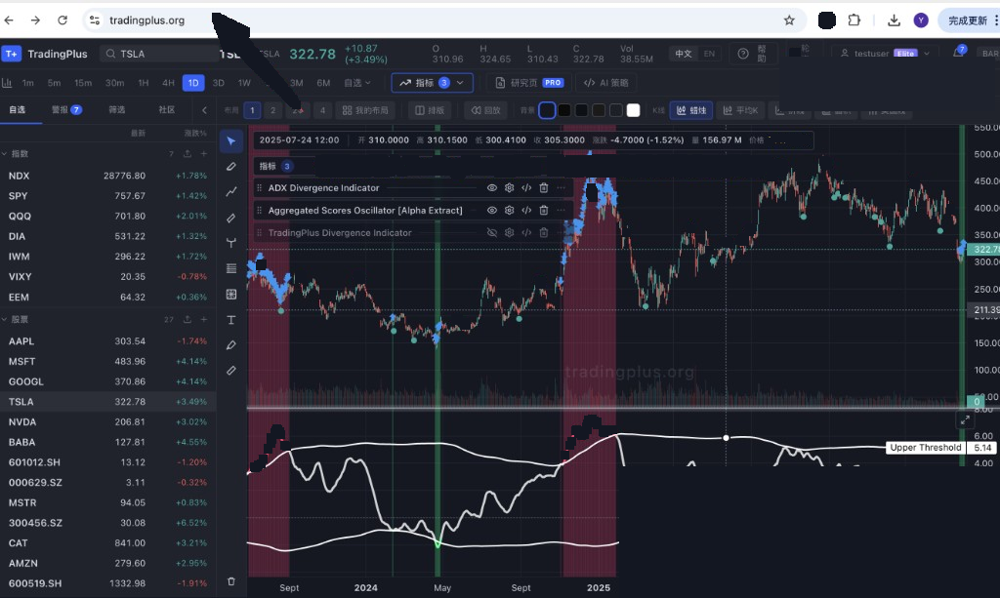
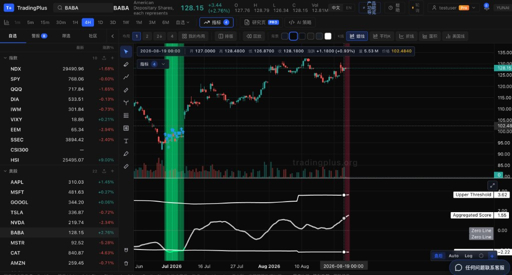

# TradingPlus

**全球行情图表与 AI 策略工作台** · Global charts & AI strategy workspace

<p align="center">
  <a href="https://tradingplus.org"></a>
  <a href="https://tradingplus.yunai.com.cn"></a>
</p>

> **这是介绍型公开仓库**（README + 截图 + 极简假数据 demo）。  
> 生产环境代码、数据管道、策略引擎 **不开源**。自托管 **暂不开放**。

## 不是 tradingplus.com

- 本产品官网是 **[tradingplus.org](https://www.tradingplus.org)**（国内站 [tradingplus.yunai.com.cn](https://tradingplus.yunai.com.cn)）。它是行情图表与策略研究工具，按软件订阅收费。
- **[tradingplus.com](https://tradingplus.com)** 是另一家做交易挑战的 Prop Firm。两边没有所有权、投资或运营关系。
- tradingplus.org 不收取交易挑战费，不出售资助账户，不托管资金，也不代客交易。
- 事实页：[tradingplus.org/about.html](https://www.tradingplus.org/about.html) · [llms.txt](https://www.tradingplus.org/llms.txt) · [实体说明仓库](https://github.com/yilan722/tradingplus-org)

---

## CTA — 立即使用

| 入口 | 说明 | 链接 |
| --- | --- | --- |
| **国际站** | 全球访问首选 | **[https://tradingplus.org](https://tradingplus.org)** |
| **国内站** | 大陆低延迟镜像（登录） | **[https://tradingplus.yunai.com.cn](https://tradingplus.yunai.com.cn)** |
| **本仓库 Demo** | Lightweight Charts + 假数据 | [打开 demo/](./demo/) |

<p align="center">
  
</p>

<p align="center">
  
</p>

---

## 产品定位

TradingPlus 面向主动交易者与研究团队，把 **多市场图表、筛选、入场线索、AI 问答、计费与企业会话** 收进同一工作台：

- **看得快** — 加密 / A·港 / 美股 / 期货 等市场的统一图表体验  
- **筛得准** — 固定股票池 + 日批缓存的多市场 Screener  
- **问得懂** — Yunai / CH 助手辅助研判（托管产品内提供）  
- **管得住** — Pro 计费；个人单会话 / 企业多会话策略  

本仓库只展示定位与可运行的图表 demo，**不包含** HQ / Screener / Yunai / 计费等实现。

---

## 功能列表（产品能力 · 文案）

| 能力 | 说明 | 本仓库 |
| --- | --- | --- |
| 多市场图表 | 现货 / 合约搜索、叠加、绘图、指标 | Demo 示意（假数据） |
| **HQ 入场** | 高质量入场标记与线索 | 文案 + demo 假标记 |
| **筛选日批** | 多市场 universe + 日批结果缓存 | 仅文案 |
| **Yunai / CH** | 研究向 AI 助手 | 仅文案 |
| **计费 / Pro** | SaaS 订阅与额度 | 仅文案 |
| **企业会话** | 企业账号多会话；个人单会话策略 | 仅文案 |
| 国内镜像 | 备案国内站，降低大陆访问延迟 | CTA 链接 |

---

## 架构示意

```text
┌────────────────────────────────────────────────────────────┐
│                    TradingPlus Workspace                   │
│  Market data → Chart engine → Indicators / overlays        │
│         ↓                                                  │
│  HQ entry · Screener (daily batch) · Yunai / CH           │
│         ↓                                                  │
│  Auth / sessions · Billing · Enterprise policy             │
└────────────────────────────────────────────────────────────┘
         │                              │
         ▼                              ▼
  tradingplus.org              tradingplus.yunai.com.cn
```

更完整的方框图见 [docs/architecture.md](./docs/architecture.md)。

---

## 技术栈说明

| 层级 | 托管产品（概览） | 本公开仓库 |
| --- | --- | --- |
| 前端 | React + 图表引擎（Lightweight Charts 系） | 静态 HTML/CSS/JS |
| 图表 | 交互 K 线、叠加、标记 | [lightweight-charts](https://github.com/tradingview/lightweight-charts) CDN |
| 后端 / 数据 | Node API、行情接入、日批任务、缓存 | —（不开源） |
| AI | Yunai / CH 助手（托管） | —（不开源） |
| 部署 | 国际站 + 国内镜像 | GitHub Pages / 任意静态托管 |

---

## 对比表（定位）

| | 通用图表站 | 纯 AI 聊天 | **TradingPlus** |
| --- | :---: | :---: | :---: |
| 多市场统一工作台 | 部分 | ✗ | ✓ |
| HQ 入场线索 | ✗ / 插件 | ✗ | ✓（产品） |
| 多市场日批筛选 | 少见 | ✗ | ✓（产品） |
| 研究助手（Yunai/CH） | ✗ | ✓ | ✓（产品） |
| 国内低延迟站 | 少见 | 视厂商 | ✓ |
| 开源自托管完整产品 | 视项目 | 视项目 | **暂不开放** |

---

## Self-hosting · 自托管

### 暂不开放 / Not available

完整 TradingPlus（行情管道、筛选日批、HQ、助手、计费、企业会话）**目前不提供自托管发行版或源码包**。

- 请使用托管产品： [tradingplus.org](https://tradingplus.org) / [国内站](https://tradingplus.yunai.com.cn)  
- 本仓库仅含介绍材料与 **假数据** demo，可随意 fork / 静态部署  
- 企业合作、白标或私有部署意向：通过产品内支持渠道联系  

---

## 本地运行 Demo

无需构建工具：

```bash
# 任意静态服务器即可，例如：
npx --yes serve .
# 然后打开 http://localhost:3000/demo/
```

或直接用浏览器打开 `demo/index.html`（部分浏览器对本地模块/CDN 策略更严，推荐用静态服务器）。

Demo 内容：

- 合成 OHLCV（`demo/data.js`）
- Candlestick + SMA20
- 示意性 HQ 标记（非真实信号）

---

## 仓库结构

```text
.
├── README.md                 # 本说明
├── LICENSE                   # MIT（仅本公开材料）
├── index.html                # 静态 landing + CTA
├── demo/                     # Lightweight Charts 假数据 demo
│   ├── index.html
│   ├── app.js
│   ├── data.js
│   └── styles.css
└── docs/
    ├── architecture.md
    └── screenshots/
```

---

## 安全与范围

- 请勿在本仓库提交密钥、私有 API、真实策略逻辑  
- 截图与文案描述产品能力；**不等于**开放实现  
- 生产站点与数据服务受单独条款约束  

---

## License

本仓库公开材料采用 [MIT](./LICENSE)。  
TradingPlus 产品名称、托管服务与专有实现保留所有权利。

---

<p align="center">
  <b><a href="https://tradingplus.org">→ 打开 TradingPlus（国际站）</a></b><br/>
  <b><a href="https://tradingplus.yunai.com.cn">→ 国内站登录</a></b>
</p>
